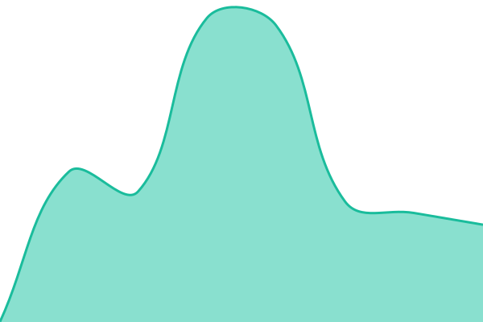
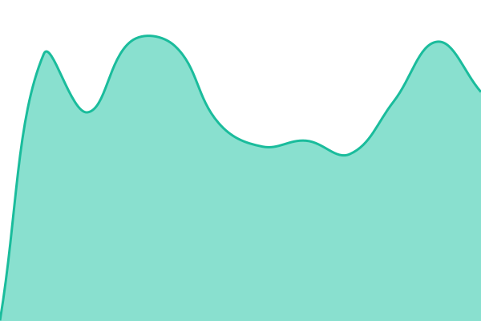
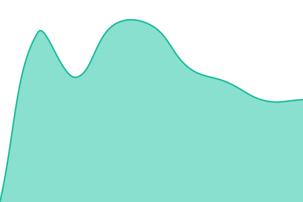
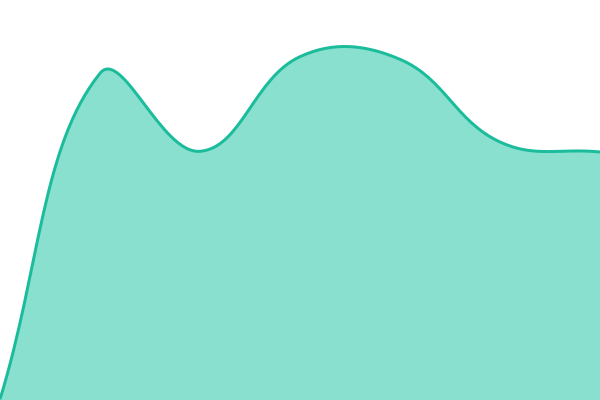

# [📈 Live Status](https://SebastiaanBoon.github.io/cafeboon-status): <!--live status--> **🟩 All systems operational**

This repository contains the open-source uptime monitor and status page for [Cafe Boon](https://cafeboon.com), powered by [Upptime](https://github.com/upptime/upptime).

With [Upptime](https://upptime.js.org), you can get your own unlimited and free uptime monitor and status page, powered entirely by a GitHub repository. We use [Issues](https://github.com/SebastiaanBoon/cafeboon-status/issues) as incident reports, [Actions](https://github.com/SebastiaanBoon/cafeboon-status/actions) as uptime monitors, and [Pages](https://SebastiaanBoon.github.io/cafeboon-status) for the status page.

<!--start: status pages-->
<!-- This summary is generated by Upptime (https://github.com/upptime/upptime) -->
<!-- Do not edit this manually, your changes will be overwritten -->
<!-- prettier-ignore -->
| URL | Status | History | Response Time | Uptime |
| --- | ------ | ------- | ------------- | ------ |
|  [Enterprise Ego, website](https://enterpriseego.cafeboon.com/) | 🟩 Up | [company-brain-website.yml](https://github.com/SebastiaanBoon/cafeboon-status/commits/HEAD/history/company-brain-website.yml) | 

 517ms
     
 | 

<a href="https://SebastiaanBoon.github.io/cafeboon-status/history/company-brain-website">100.00%</a>
    

|  [Enterprise Ego, health check](https://enterpriseego.cafeboon.com/healthz) | 🟩 Up | [company-brain-health.yml](https://github.com/SebastiaanBoon/cafeboon-status/commits/HEAD/history/company-brain-health.yml) | 

 396ms
     
 | 

<a href="https://SebastiaanBoon.github.io/cafeboon-status/history/company-brain-health">100.00%</a>
    

|  [Enterprise Ego, MCP endpoint](https://enterpriseego.cafeboon.com/mcp) | 🟩 Up | [company-brain-mcp.yml](https://github.com/SebastiaanBoon/cafeboon-status/commits/HEAD/history/company-brain-mcp.yml) | 

 386ms
     
 | 

<a href="https://SebastiaanBoon.github.io/cafeboon-status/history/company-brain-mcp">100.00%</a>
    

|  [Alter Ego, website](https://cloudalterego.cafeboon.com/) | 🟩 Up | [alter-ego-website.yml](https://github.com/SebastiaanBoon/cafeboon-status/commits/HEAD/history/alter-ego-website.yml) | 

 522ms
     
 | 

<a href="https://SebastiaanBoon.github.io/cafeboon-status/history/alter-ego-website">100.00%</a>
    

|  [Alter Ego, health check](https://cloudalterego.cafeboon.com/healthz) | 🟩 Up | [alter-ego-health.yml](https://github.com/SebastiaanBoon/cafeboon-status/commits/HEAD/history/alter-ego-health.yml) | 

 388ms
     
 | 

<a href="https://SebastiaanBoon.github.io/cafeboon-status/history/alter-ego-health">100.00%</a>
    

|  [Alter Ego, MCP endpoint](https://cloudalterego.cafeboon.com/mcp) | 🟩 Up | [alter-ego-mcp.yml](https://github.com/SebastiaanBoon/cafeboon-status/commits/HEAD/history/alter-ego-mcp.yml) | 

 381ms
     
 | 

<a href="https://SebastiaanBoon.github.io/cafeboon-status/history/alter-ego-mcp">100.00%</a>
    

|  [PE Screener, website](https://pe-screener.cafeboon.com/) | 🟩 Up | [pe-screener-website.yml](https://github.com/SebastiaanBoon/cafeboon-status/commits/HEAD/history/pe-screener-website.yml) | 

 635ms
     
 | 

<a href="https://SebastiaanBoon.github.io/cafeboon-status/history/pe-screener-website">100.00%</a>
    

|  [PE Screener, health check](https://pe-screener.cafeboon.com/healthz) | 🟩 Up | [pe-screener-health.yml](https://github.com/SebastiaanBoon/cafeboon-status/commits/HEAD/history/pe-screener-health.yml) | 

 385ms
     
 | 

<a href="https://SebastiaanBoon.github.io/cafeboon-status/history/pe-screener-health">100.00%</a>
    

<!--end: status pages-->

[**Visit our status website →**](https://SebastiaanBoon.github.io/cafeboon-status)

## 📄 License

- Powered by: [Upptime](https://github.com/upptime/upptime)
- Code: [MIT](./LICENSE) © [Anand Chowdhary](https://anandchowdhary.com)
- Data in the `./history` directory: [Open Database License](https://opendatacommons.org/licenses/odbl/1-0/)
